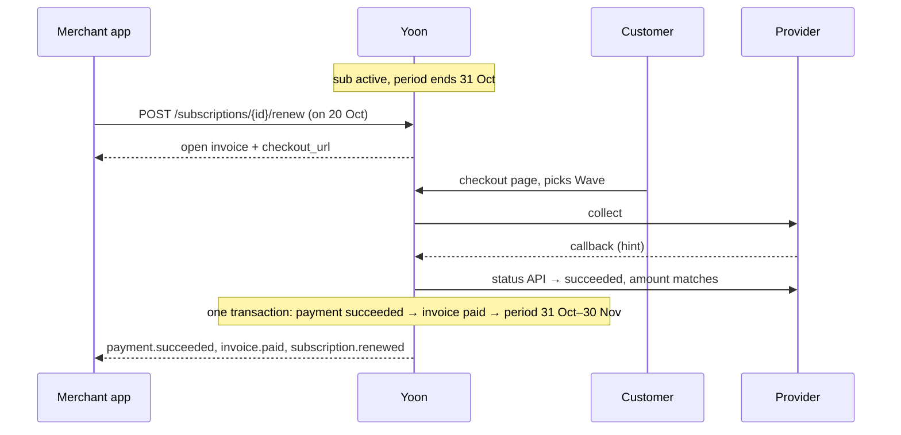
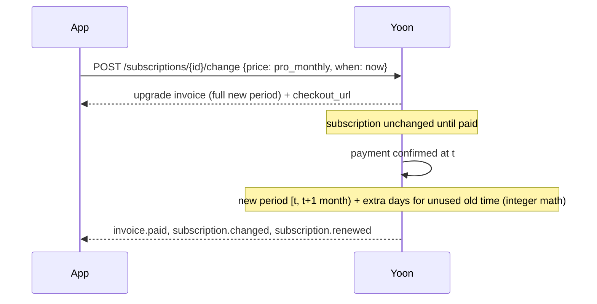
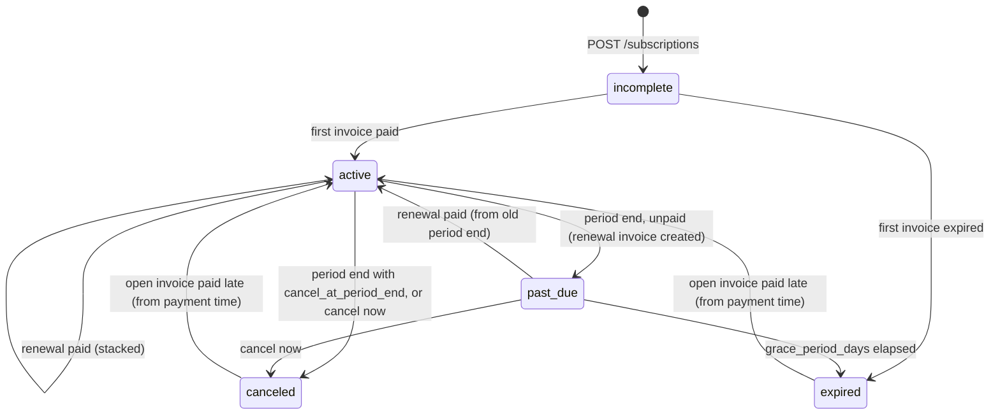

# Plan — billing in 0.3.0 (prepaid subscriptions)

Design: [ADR-0025](../adr/0025-customers-and-catalog.md) (customers, plans, prices),
[ADR-0026](../adr/0026-subscriptions-prepaid.md) (subscriptions, lifecycle),
[ADR-0027](../adr/0027-invoices-and-receipts.md) (invoices, receipts).
Status: **proposed — for review before any code.** Reference merchant: OSIG (FastAPI SaaS).

Out of 0.3.0, planned for 0.4.0: `automatic` collection + dunning (Stripe first, provider
capability), customer portal, PDF receipts.

## 1. API (all additive; `/v1/payments` unchanged)

Every write takes `Idempotency-Key`. Lists: newest first, `starting_after`, `limit` ≤ 100,
`{data, has_more, next_cursor}`. Errors: problem+json with a stable `code`.

| Method | Path | Notes |
| --- | --- | --- |
| POST | `/v1/customers` | `{external_id, email?, phone?, pi_alias?, country, name?, metadata?}`; `409 customer_exists` if `external_id` is taken (body: the existing id) |
| GET | `/v1/customers` | `?external_id=` exact match |
| GET / PATCH | `/v1/customers/{id}` | PATCH: every field but `external_id` |
| POST | `/v1/plans` | `{slug, name, features?, metadata?, prices?: [PriceInput]}` |
| GET | `/v1/plans` | `?active=true` |
| GET / PATCH | `/v1/plans/{id}` | PATCH: `name`, `active`, `features`, `metadata` |
| POST | `/v1/plans/{id}/prices` | `{currency, amount, interval, interval_count?}` |
| GET / PATCH | `/v1/prices/{id}` | PATCH: `active` only (prices are immutable) |
| POST | `/v1/subscriptions` | `{customer, price, collection_method?: "prepaid_manual", grace_period_days?, metadata?, return_url}` → `incomplete` + `latest_invoice.checkout_url` |
| GET | `/v1/subscriptions` | `?customer=&status=` |
| GET | `/v1/subscriptions/{id}` | includes `features`, `pending_change`, `latest_invoice` |
| GET | `/v1/subscriptions/{id}/events` | status history |
| POST | `/v1/subscriptions/{id}/renew` | `{return_url}` → the open invoice (created if none) with `checkout_url` |
| POST | `/v1/subscriptions/{id}/change` | `{price, when?: "now" \| "period_end"}` (ADR-0026 rules) |
| POST | `/v1/subscriptions/{id}/cancel` | `{at_period_end?: true}` |
| POST | `/v1/subscriptions/{id}/resume` | clears `cancel_at_period_end` |
| GET | `/v1/invoices` | `?customer=&subscription=&status=` |
| GET | `/v1/invoices/{id}` | `receipt_url` once paid |
| GET | `/v1/exports/subscriptions.csv`, `/v1/exports/invoices.csv` | like the other exports |
| GET | `/receipts/{invoice}?t=` | public, token-scoped HTML receipt (ADR-0027) |
| GET | `/admin/v1/applications/{app}/{plans,subscriptions,invoices}` (+ `/{id}/events`) | operator read views, delegating to `/v1` |
| POST | `/admin/v1/applications/{app}/subscriptions/{id}/comp` | `{price, periods, note}` |

Additive fields: `Payment.customer`, `Payment.subscription`, `Payment.invoice` (nullable
strings). New event types: `subscription.{created,activated,renewed,past_due,expired,canceled,changed,renewal_upcoming}`,
`invoice.{created,paid,voided}` — `EventType` becomes an open set (ADR-0026, "Contract").

### Example — OSIG's monthly plan

```http
POST /v1/plans
{"slug": "pro", "name": "OSIG Pro", "features": {"seats": 5, "exports": true},
 "prices": [{"currency": "XOF", "amount": 15000, "interval": "month"},
            {"currency": "XOF", "amount": 150000, "interval": "year"}]}

POST /v1/subscriptions
{"customer": "cus_…", "price": "price_…", "return_url": "https://osig.example/billing"}
→ 201 {"id": "sub_…", "status": "incomplete",
       "latest_invoice": {"id": "in_…", "number": "INV-2026-000001", "amount_due": 15000,
                          "status": "open", "checkout_url": "https://pay.osig.example/checkout/pay_…?t=…"}}
```

## 2. Flows

### Renew early (stacking)



### Upgrade now



### Grace → expired



## 3. Data (migration `V7__billing.sql`)
`customers`, `plans`, `prices`, `subscriptions`, `invoices`, `invoice_lines`,
`invoice_counters`; `payments` gains `customer_id`, `subscription_id`, `invoice_id` (nullable).
Constraints: unique `(application_id, external_id)` on customers, `(application_id, slug)` on
plans, `(application_id, number)` on invoices; partial unique index "one open invoice per
subscription"; amounts `bigint CHECK (> 0)`; status `CHECK` lists.

## 4. Milestones (each: tests + docs + CHANGELOG, then stop for review/commit)
1. **Core:** `SubscriptionStatus` and `InvoiceStatus` state machines with full matrices;
   period arithmetic (`BillingPeriods`: anchors, month ends, leap years) and the upgrade
   extra-days calculation, pure and exhaustively unit-tested.
2. **Catalog + customers:** V7 migration (all billing tables), customers/plans/prices API,
   contract, regenerated clients, `EventType` open-set handling + CI ignore file + client checks.
3. **Subscriptions + invoices:** create/renew/change/cancel/resume, `SubscriptionTransitions`,
   invoice numbering, the payment → invoice → subscription hook inside `PaymentTransitions`,
   events.
4. **Lifecycle:** `BillingSweep` (reminders, period end, grace end, incomplete expiry) with an
   injected `Clock`; ShedLock; settings; metrics + alert on billing sweep errors.
5. **Pages + operator:** receipt page, checkout shows plan/period, dashboard tabs, comp
   (CLI + admin API), CSV exports.
6. **Clients + docs:** Python FastAPI and JS Next.js helpers for subscription events and
   checkout redirects; "Billing for SaaS" docs page with a FastAPI example; website; OSIG
   migration note.

## 5. Tests (beyond the usual contract/response validation)
- Stacking: early renewal, renewal in grace (from old end), after expiry (from payment time).
- Anchors: 31 Jan → 28/29 Feb → 31 Mar; yearly on 29 Feb.
- Upgrade extra days; downgrade applied at period end; currency change refused.
- Duplicate `payment.succeeded` → one period added. Concurrent `renew` → one open invoice.
  Concurrent payment + period-end sweep → consistent (row locks).
- Amount mismatch → invoice stays open, subscription unchanged, alert.
- Late payment of a voided/expired invoice → re-activated + alert.
- Sweeps idempotent: running twice changes nothing; two instances → each row once.
- Comp: periods added, no payment, no ledger posting.
- Demo provider end to end: create → pay on checkout → active → time moved → past_due →
  renew → active → time moved past grace → expired.

## 6. Open questions for review
1. **Entitled in `past_due`?** Proposed: yes (grace means "still works, pay soon"); merchants can
   stop at `past_due` if they prefer. OK for OSIG?
2. **Invoice due window** default 7 days and **grace** default 3 days — OSIG's real values?
3. **OSIG today:** to write the migration note, I need OSIG's current plans table, renewal logic
   and webhook handler (or a description).
